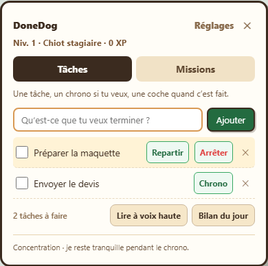

# 🐕 DoneDog

**Ton collègue a quatre pattes. Et un avis.**

Un chien en pixel art sur ton bureau Windows : ajoute tes tâches, lance un chrono,
suis tes missions freelance et laisse-le commenter ta journée. Gratuit, sans compte,
avec des voix en français et en anglais. Code source sous licence MIT.

## Télécharger

| Version Windows x64 | Utilisation |
| --- | --- |
| **[ZIP sans installation](https://github.com/Misterbra/Donedog/releases/latest/download/DoneDog-Windows-x64.zip)** | Télécharge, fais **Extraire tout**, puis ouvre **DoneDog.exe** dans le dossier extrait. |
| **[Installeur Windows](https://github.com/Misterbra/Donedog/releases/latest/download/DoneDog-Windows-x64.exe)** | Télécharge et ouvre le fichier pour installer DoneDog. |
| [Empreintes SHA-256](https://github.com/Misterbra/Donedog/releases/latest/download/SHA256SUMS.txt) | Pour vérifier l’intégrité des deux téléchargements. |

Garde tous les fichiers du ZIP ensemble : l’exécutable a besoin des dossiers voisins.
Les deux versions enregistrent tes données dans `%APPDATA%\taskdog`. Le ZIP évite
l’installation ; les données restent sur le PC, pas à côté de l’exécutable.

Testé sous Windows 11 x64. Les fichiers ne sont pas signés numériquement : Windows
peut afficher un avertissement d’éditeur inconnu. Pas de version macOS, Linux ou ARM64.
[Voir la release et ses détails](https://github.com/Misterbra/Donedog/releases/latest).

## En une minute

1. Clique sur le chien pour ouvrir ses **Tâches**. Ajoute ce que tu veux terminer.
2. Lance un chrono si tu veux, puis coche la tâche accomplie : il gagne de l’XP.
3. Dans **Missions**, suis ton temps par client, ton budget et tes sessions ; exporte en CSV.
4. Dans **Réglages**, choisis la langue, le volume et sa présence : **Discret**, **Complice** ou **Bavard**.

Il se promène, saute sur les fenêtres, dort quand le PC reste inactif et se pose
pendant les chronos. Tu peux le déplacer en le faisant glisser, lui donner un nom,
remplacer sa tête par une photo ou choisir son alter ego humain à quatre pattes.
L’icône près de l’horloge Windows permet de le cacher, de le quitter et d’activer
le lancement au démarrage.



## Ce qu’il observe

DoneDog utilise des règles et des répliques écrites. Il repère les titres et les
positions des fenêtres pour se déplacer et choisir ses remarques. Il ne lit pas
le contenu des pages, les documents ou les onglets masqués, et ne capture pas l’écran.
Un titre de fenêtre n’est pas une preuve de procrastination.

Le temps par application est une estimation basée sur la fenêtre au premier plan.
Les interruptions et l’inactivité sont exclues ; une lecture prolongée sans clavier
ni souris peut donc être sous-comptée. Le compagnon utilise l’écran principal.

## Données et voix

- Tâches, missions, réglages et photos restent dans `%APPDATA%\taskdog`.
- Une copie `.bak` conserve la révision valide précédente de chaque fichier JSON
  modifié. Si l’original devient illisible, DoneDog essaie cette copie et t’avertit.
  Avant de remplacer un fichier endommagé, il en conserve les octets sous `.corrupt-…`.
  Si une écriture échoue, une alerte propose de réessayer. Ce secours local ne remplace
  pas une sauvegarde du PC.
- Les 66 clips vocaux FR/EN sont inclus. Aucune clé API n’est nécessaire pour les entendre.
- La météo utilise une localisation approximative par IP via ipapi.co et Open-Meteo.
  Couper le son ne désactive ni la météo ni l’observation des fenêtres.
- La voix dynamique Gemini est optionnelle. Pour l’activer dans l’application téléchargée,
  copie le format de `gemini-keys.example.json` dans `%APPDATA%\taskdog\gemini-keys.json`,
  ajoute ta propre clé et redémarre DoneDog. En développement, le fichier va à la racine
  du projet. Il n’est jamais inclus dans les téléchargements.
- Avec cette option, le texte à lire est envoyé à Google, y compris les tâches si tu
  demandes leur lecture. Les remarques signalées comme contenant des titres de fenêtres
  utilisent la voix Windows locale. Les éventuels quotas ou frais Google sont indépendants
  de DoneDog. Sans clé, les clips inclus et les voix Windows servent de repli.

## Développement

Node.js 24 et Windows x64 recommandés.

```sh
git clone https://github.com/Misterbra/Donedog.git
cd Donedog
npm ci
npm start
```

Electron, sans dépendance applicative supplémentaire. Les sprites sont dessinés
depuis des matrices dans `src/renderer/sprites.js`. Le détecteur Windows utilise
le script PowerShell `src/native/window-watcher.ps1`. Les phrases se trouvent dans
`phrases.js`, `brain.js` et `roast-engine.js` ; le script des voix dans `assets/sounds/README.md`.

```sh
npm test              # Logique, activité et récupération des sauvegardes
npm run test:ui       # Parcours FR/EN dans une fenêtre Electron invisible, données fictives
npm run dist          # Installeur + ZIP dans dist/
npm run test:package  # Détecteur Windows et reprise après arrêt de PowerShell
npm run test:release  # Extraction du ZIP, sources, voix, confidentialité et SHA-256
```

## Publication automatique

Le [workflow Windows](.github/workflows/windows.yml) vérifie les commits sur `main`
et les pull requests. Un tag `vX.Y.Z` correspondant à la version de `package.json`
déclenche aussi la publication d’une release avec le ZIP, l’installeur et leurs
empreintes SHA-256. Les tests doivent réussir avant publication.

Pour une prochaine version : modifier `docs/release-notes.md`, créer le commit,
mettre à jour le numéro avec `npm version patch`, puis pousser le commit et le tag.
Le workflow peut aussi être lancé manuellement pour vérifier un build sans publier de release.

## English

A free Windows desktop dog with tasks, focus timers, freelance mission tracking,
French / English voices and adjustable personality. No account required.
Download the **ZIP** above, extract everything and open **DoneDog.exe**, or use
the **Windows installer**. Both editions store data in `%APPDATA%\taskdog`.
Switch to English in Settings. MIT-licensed source; unsigned Windows x64 binaries.

Made by **[@N2bbg](https://instagram.com/n2bbg)**.
